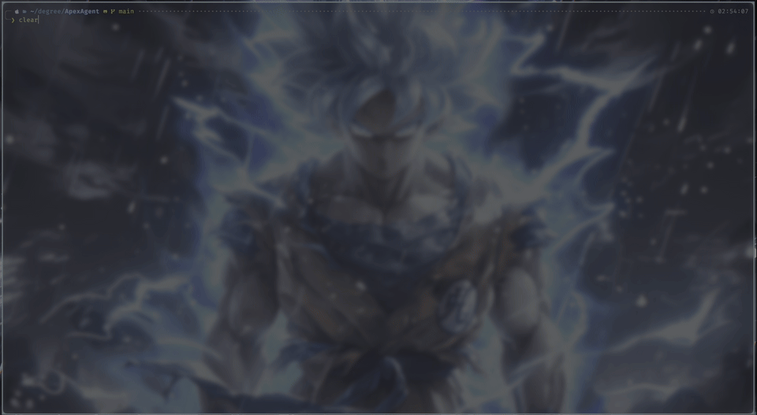

# ApexAgent

> A macOS native voice agent built in Swift. Local LLM inference. Online/offline fallback. 100% terminal-built. One week, hardcore mode.

## Package layout

One Swift package, three parts:

| Part | What it is | Run it |
|---|---|---|
| `NotchCore` | The notch window, the study timer, habits and categories, and their data files. Shared library. | (used by the two apps) |
| `ApexAgent` | The voice agent: mic, LLM, TTS, Mac actions. Shows its state in the notch. Study data in `data/`. | `swift run ApexAgent` |
| `StudyNotch` | The study notch on its own, for other Mac users. No mic, no API keys, no shell. Menu-bar icon to find the data or quit. Data in `~/Library/Application Support/StudyNotch/`. | `swift run StudyNotch` |

Categories: Academic, Health, Soul and Personal are built in. Add your own with the **+** after the tabs in the notch
(saved in `categories.json`); right-click a custom tab to remove it once it has no activities. The web report picks them up.

Tests: `./scripts/test.sh` (this Mac has only the Command Line Tools). CI runs `swift build` and `swift test` on GitHub's macOS runner
(`.github/workflows/ci.yml`). Reviewer agents for Claude Code are in `.claude/agents/` (`swift-reviewer`, `aws-cost-guard`).

Not done yet for StudyNotch: the habit report is still built by `scripts/study_report.py` (ApexAgent only), and launch at login
needs a real `.app` bundle.

## How to Use

### 1. Set up once

Requirements: macOS 13 or later, Swift (the Command Line Tools are enough, no Xcode needed).
For offline use, also [Ollama](https://ollama.com) with the model pulled: `ollama pull qwen3:8b`.

Create a `.env` file in this folder (it is read at startup and never committed):

```
DEEPSEEK_API_KEY=your-deepseek-key     # the cloud LLM (online)
DEEPGRAM_API_KEY=your-deepgram-key     # cloud speech-to-text and the natural voice (online)
```

Build:

```
swift build
```

The first time you use the mic, macOS asks for **Microphone** permission (and, for the Apple mic mode,
**Speech Recognition**). Allow both for the terminal app you run it from (kitty, Terminal, iTerm).
Screenshots ask for **Screen Recording** the first time, and dark mode asks to control **System Events**.

### 2. Run it

Always run from this folder, so it finds `.env`:

```
swift run ApexAgent
```

You get a typed prompt (`ApexAgent>`) and the notch animation at the top of the screen.
Type a request, or turn on the mic:

| Type this | What it does |
|---|---|
| any request, e.g. `open spotify and play music` | sends it to the agent |
| `/mic` | starts listening; press **Enter** to stop the mic |
| `help` | lists the built-in commands |
| `clear` | forgets the conversation so far |
| `/model` / `/model qwen3:4b` | lists or switches the local (Ollama) model |
| `/thinking on` / `/thinking off` | lets the local model reason first (slower) |
| `exit` | closes ApexAgent (saying "exit" or "quit ApexAgent" by voice works too) |

### 3. Choose the mode (environment variables)

Put these in front of `swift run ApexAgent`. They can be combined.

| Variable | Effect | Example |
|---|---|---|
| `APEX_STT=apple` | **Apple on-device mic**: Apple's speech recognition on your Mac instead of Deepgram. No audio leaves the Mac, and it was more accurate on quiet, noisy speech in our tests; about 0.7 s slower to respond. | `APEX_STT=apple swift run ApexAgent` |
| `APEX_FORCE_OFFLINE=1` | Local brain: uses Ollama (qwen3:8b) instead of the cloud LLM, and the built-in macOS voice instead of Deepgram's. | `APEX_FORCE_OFFLINE=1 swift run ApexAgent` |
| `APEX_VOICE_PROCESSING=1` | Turns on macOS noise suppression and echo cancellation for the mic. | `APEX_VOICE_PROCESSING=1 swift run ApexAgent` |
| `APEX_NOTCH=0` | No notch animation, terminal only. | `APEX_NOTCH=0 swift run ApexAgent` |

Common setups:

```
swift run ApexAgent                                          # default: Deepgram mic + DeepSeek + Deepgram voice
APEX_STT=apple swift run ApexAgent                           # Apple mic (recommended if you get misheard)
APEX_STT=apple APEX_FORCE_OFFLINE=1 swift run ApexAgent      # fully on-device: Apple mic + Ollama + macOS voice
```

Then type `/mic` and talk.

### 4. What you can say

- **Apps:** "open Safari", "quit Spotify" (the app must be named; "close the window" does nothing on purpose)
- **Music:** "play music", "pause", "next song", "previous song"
- **Web:** "open YouTube", "search YouTube for lofi", "search Netflix for Avatar"
- **Mac:** "set volume to 40", "what's my battery", "what time is it", "take a screenshot",
  "lock the screen", "turn on dark mode", "set a timer for 10 minutes", "new terminal"
- **Shortcuts:** "run take a break" (any of your Shortcuts, by its exact name)
- **Several steps at once:** "open Spotify and play music",
  "check my battery and if it's below 50 percent turn on dark mode".
  It does one step at a time, checks the real result, then does the next (at most 5 steps).
  If you pause after "and", it waits up to 2.5 s for the rest of the sentence.

It will not do what it has no tool for (send messages, delete files) and says so instead of pretending.

### 5. Tests, evals and logs

```
./scripts/test.sh                              # unit tests (exit phrases, unfinished commands)
python3 evals/hallucination/run.py 0.1 2       # wrong-tool / false-claim rate on 21 requests
python3 evals/agent_loop/run_loop.py 2         # 12 multi-step tasks through the agent loop (tools simulated)
```

Every request is timed in `logs/latency.jsonl` (one JSON line per stage: speech-to-text, LLM, each
agent step, first audio). It contains what you said, so `logs/*.jsonl` is in `.gitignore`.

After editing `Sources/ApexAgent/prompts/system_prompt.txt`, run `swift build` again: the prompt is
bundled into the app at build time.

## Demo

**Demo video:** [Watch the demo](media/simpledemo.mp4)


Phase 1 & 2: Command router + local LLM (Ollama/qwen3:8b) understanding natural language.

## What Is This

ApexAgent is a personal AI assistant for macOS — think Jarvis, but running entirely on your machine. It listens to your voice, understands natural language, controls your Mac, and speaks back. No cloud dependency required.

Built from scratch in Swift. No Xcode. No tutorials. Just `vim` + `swift build` + `swift run`.

## Architecture

```
┌─────────────────────────────────────────────────────────┐
│                      ApexAgent                           │
│                                                          │
│   Voice Input (STT)                                     │
│     ├─ Default:        Deepgram nova-2 (WebSocket)       │
│     └─ APEX_STT=apple: Apple Speech (on-device)          │
│             ↓                                            │
│   Intent Understanding (LLM) + agent loop (≤ 5 steps)   │
│     ├─ Online:  DeepSeek (OpenAI-compatible API)        │
│     └─ Offline: Ollama + Qwen3 8B (local)               │
│             ↓                                            │
│   Tool Execution (guarded)                               │
│     └─ Shell + AppleScript: apps, music, web, volume,   │
│        timer, screenshot, lock, dark mode, Shortcuts    │
│             ↓                                            │
│   Voice Output (TTS)                                    │
│     ├─ Online:  Deepgram Aura-2 (natural voice)          │
│     └─ Offline: AVSpeechSynthesizer (built-in)          │
└─────────────────────────────────────────────────────────┘
```

The agent auto-detects network status. Online → cloud APIs (smarter, faster). Offline → local models (private, no internet needed). The user never notices the switch.

## One Week Sprint — Build Plan

| Day | Phase | Goal | Done When |
|---|---|---|---|
| 1 (Thu) | Command Router | Terminal REPL with hardcoded commands | `open spotify` opens Spotify |
| 2 (Fri) | Local LLM | Ollama integration, natural language routing | "crank up the volume" → volume 80 |
| 3 (Sat) | Online/Offline Fallback | GLM + Ollama auto-switch | Kill wifi → still works |
| 4 (Sun) | Voice Input (STT) | Apple Speech + Deepgram | Speak "open spotify" → it opens |
| 5 (Mon) | Voice Output (TTS) | AVSpeech + Deepgram Aura-2 | Agent speaks back |
| 6 (Tue) | macOS UI | SwiftUI menu bar chat app | Not a terminal anymore |
| 7 (Wed) | Polish + Demo | Bug fix, record demo video | Portfolio-ready |

## What I Will Learn

### Swift Language

- **Optionals** (`?` `!` `if let`) — the core Swift concept, no Python equivalent
- **Structs vs Classes** — value types vs reference types, when to use each
- **Enums with associated values** — Swift's superpower, Python has nothing like this
- **Protocols** — like Python ABCs but enforced at compile time
- **Closures** — Swift's lambdas, trailing closure syntax
- **Error handling** (`try/catch/throw`) — different from Python's try/except
- **Async/await** — concurrency, continuations, actors
- **String interpolation** (`\(variable)`) — like f-strings but different syntax

### Data Structures

- **Arrays** — `map`, `filter`, `forEach`, `contains`
- **Dictionaries** — `Dictionary(uniqueKeysWithValues:)`, optional value access
- **Sets** — fast O(1) lookup
- **Tuples** — fixed-size, named elements
- **Custom structs** — building your own data containers
- **Enums as state machines** — modeling intent with associated values

### macOS Frameworks

- **Process** — run shell commands from Swift (`open`, `osascript`, `pmset`)
- **SwiftUI** — declarative UI: `View`, `@State`, `@Binding`, `VStack`, `HStack`
- **AppKit integration** — menu bar, window lifecycle, `MenuBarExtra`
- **AVFoundation** — `AVAudioEngine` for mic capture, `AVAudioPlayer` for playback
- **AVSpeechSynthesizer** — built-in text-to-speech, no API key needed
- **Speech framework** — `SFSpeechRecognizer`, on-device streaming STT
- **Network framework** — `NWPathMonitor` for online/offline detection
- **Accessibility API** — read and click UI elements in other apps

### Networking

- **URLSession** — HTTP POST/GET to Ollama and GLM APIs
- **JSONDecoder/Encoder** — parse LLM JSON responses
- **WebSocket** — streaming audio to Deepgram Flux
- **Async networking** — `async/await` with `URLSession.data`
- **Protocol-oriented design** — `LLMProvider` protocol, swap implementations at runtime

### AI Engineering

- **Local LLM inference** — Ollama, model quantization, memory budget on M1 Pro
- **Prompt engineering** — system prompts for JSON intent extraction
- **Tool calling** — LLM picks a tool from a registry, fills arguments, executes
- **Two-mode architecture** — online (cloud) vs offline (local), graceful degradation
- **Voice pipeline** — STT → LLM → tool → TTS, the full loop
- **Streaming responses** — SSE-style partial results from both STT and LLM

### Software Engineering

- **Swift Package Manager** — `Package.swift`, dependencies, targets
- **Terminal-first workflow** — `vim` + `swift build` + `swift run`, no IDE
- **Git discipline** — daily commits, one feature per commit
- **Protocol-based architecture** — `LLMProvider`, `STTProvider`, `TTSProvider`
- **Error handling at boundaries** — user input, network, audio, shell commands
- **TCC permissions** — microphone, accessibility, automation consent

## Tech Stack

| Component | Technology | Cost |
|---|---|---|
| Language | Swift 6 | Free |
| Build | Swift Package Manager | Free |
| Editor | Vim | Free |
| Local LLM | Ollama + Qwen3 8B | Free |
| Cloud LLM | GLM API (DeepSeek-compatible) | Cheap |
| Online STT | Deepgram Flux | Free $200 credit |
| Offline STT | Apple Speech framework | Free |
| Online TTS | Deepgram Aura-2 | Free $200 credit |
| Offline TTS | AVSpeechSynthesizer | Free |
| Vector store (future) | ChromaDB / MLX | Free |

## Hardware

- **Machine:** MacBook Pro M1 Pro (32GB unified memory, 16 cores)
- **Memory bandwidth:** 200 GB/s
- **Local LLM budget:** ~24GB usable for model + context
- **Metal support:** Metal 4

## Project Structure

```
ApexAgent/
├── Package.swift                  # SPM manifest
├── Sources/
│   └── ApexAgent/
│       ├── ApexAgent.swift         # entry point
│       ├── (future files...)
│       │   ├── CommandRouter.swift     # Phase 1 — parse + route commands
│       │   ├── ShellRunner.swift        # Phase 1 — Process() wrapper
│       │   ├── OllamaProvider.swift     # Phase 2 — local LLM
│       │   ├── GLMProvider.swift        # Phase 3 — cloud LLM
│       │   ├── LLMProvider.swift        # Phase 3 — protocol
│       │   ├── NetworkMonitor.swift     # Phase 3 — online/offline
│       │   ├── AudioRecorder.swift      # Phase 4 — mic capture
│       │   ├── SpeechProvider.swift     # Phase 4 — Apple STT
│       │   ├── DeepgramSTT.swift        # Phase 4 — Deepgram STT
│       │   ├── SpeechSynthesizer.swift  # Phase 5 — AVSpeech TTS
│       │   ├── DeepgramTTS.swift        # Phase 5 — Deepgram TTS
│       │   └── ContentView.swift       # Phase 6 — SwiftUI
├── Tests/
│   └── ApexAgentTests/
└── README.md
```

## Reference Projects

- **Computah** (`~/degree/PersonalAgentic/computah/`) — Swift macOS notch app with Deepgram + Jev + Accessibility API. Used as reference for voice, LLM calls, and app structure. Not forked — patterns are studied and reimplemented.

## The Rule

```
No tutorials. No courses. No "let me watch one more video."

  Write code → build → fix errors → repeat.

  The compiler is your teacher.
  The terminal is your classroom.
  The deadline is your motivator.
```

## Author

**Nik** (@nickaqmal02) — Final-year CS student, aspiring AI Engineer. Building this to learn native macOS development and local LLM integration in one focused week.

## License

MIT
